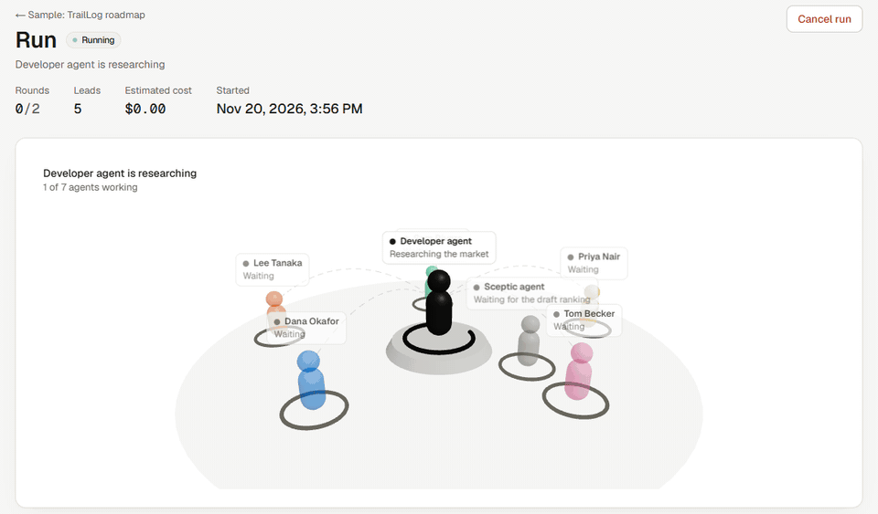

# Feature Research Platform

Decide what to build next. A developer agent researches feature ideas for a business, one agent per sales lead reacts to them over several rounds, a sceptic agent challenges the result, and you get a ranked roadmap you can hand straight to a coding agent.



<sub>A run on the fictional sample project: the developer agent in the centre, the lead agents around it, the sceptic, and messages travelling between them. Sped up.</sub>

It runs locally on your machine and uses your Claude Code login, so there is nothing to host and no API key to set up. Data stays in JSON files under `data/`.

## Run it

```bash
npm install
npm run dev
```

Open http://localhost:3000 and load the sample project from the home page, or create your own.

Agents run through the [Claude Agent SDK](https://docs.claude.com/en/docs/agent-sdk/overview), which uses the Claude Code login on this machine by default. To use an Anthropic API key instead, copy `.env.example` to `.env.local`, set `ANTHROPIC_API_KEY`, and switch the mode in Settings. Runs on the larger models can cost a few dollars; the run page shows the estimated cost, and Settings lets you pick cheaper models.

## How a run works

1. **Persona briefs** (optional). One agent per lead researches the lead's company and role, using the `account-research`, `lead-triage` and `stakeholder-map` skills from Anthropic's sales plugin. Briefs are saved and reused in later runs while the lead is unchanged.
2. **Research.** The developer agent researches the business (optionally with web search) and proposes candidate features, using the `competitive-brief` and `product-brainstorming` skills from Anthropic's product-management plugin.
3. **Feedback rounds.** Each lead agent scores every feature from 1 to 5, spends a 10-point budget across them, names its single top pick and says how likely it would be to buy. Then (optional) every lead reads the others' positions and may revise or push back. The developer agent revises the list with the `synthesize-research` skill. This repeats for the chosen number of rounds.
4. **Draft ranking.** The developer agent gives RICE inputs for the final list (`roadmap-update` skill). `rice_prioritizer.py` computes the scores and lays the features out quarter by quarter against the team capacity.
5. **Sceptic review** (optional). A sceptic agent looks for rankings that rest on one lead, guessed estimates and ignored objections. The developer agent answers each point and produces the final ranking, and the page shows what moved.

While a run is in progress you can:

- **Watch it** in a live 3D view of the agents, each with its current state and activity.
- **Send notes** to the agents. A liaison agent restates your note with the run's context and passes it to the developer agent, and to the leads when you want something asked of them.
- **Cancel, resume or extend it.** Finished steps are never repeated, so a failed run resumes where it stopped, and a finished one can get another round.

## From ranking to code

Each ranked feature has **Copy brief** and **Download .md** buttons. The brief holds the feature, why it ranks where it does, what each lead said, the risks and the sceptic's challenges, your notes and the product context, plus instructions for a coding agent. Paste it into a Claude Code session opened in the repository where the feature will be built: it explores the code, proposes a plan and acceptance criteria, and checks them with you before writing code.

Lead agents are simulated from profile data. Treat the ranking as a way to focus real customer conversations, not as a replacement for them.

## Data sources

- **Manual**: describe the business and at least 5 leads.
- **Sample**: the home page offers to load the fictional project in `samples/traillog.json`.
- **Apollo.io**: OAuth connection (see Settings for the registration steps and `.env.example` for the variables). Apollo must approve the OAuth app and requires an https redirect URL, so `APOLLO_API_KEY` is supported as a development fallback. Importing the business profile costs 1 Apollo credit; loading saved contacts is free but needs a paid Apollo plan. Emails and phone numbers are not imported. This integration has not yet been tested against a live Apollo account.

## Third-party skills and scripts

The skills and scripts above are vendored under `vendor/` with their licences; see `vendor/README.md` for sources and commits. The plugins' connector configuration is left out, so agents never connect to a CRM, chat or email. Lead agents get no skills or tools at all.

The two Python scripts need Python 3 on the PATH (or `PYTHON_PATH` in `.env.local`). Without Python, scores come from a built-in copy of the same formula and the text analysis is skipped.

## Layout

- `src/lib/engine.ts`: runs one agent turn through the Agent SDK (local login or API key), with structured output.
- `src/lib/orchestrator.ts`: the run pipeline (briefs, research, feedback, revision, ranking, sceptic, notes); every step is checkpointed so runs can resume.
- `src/lib/prompts.ts`: prompts for the developer, lead, sceptic and liaison agents.
- `src/lib/brief.ts`: builds the per-feature briefs.
- `src/lib/apollo.ts`: Apollo OAuth and API calls.
- `src/lib/toolkit.ts` and `scripts/pm_toolkit_bridge.py`: run the vendored Python scripts.
- `src/lib/scene.ts` and `src/components/AgentScene.tsx`: the live 3D agent view (three.js, react-three-fiber).
- `src/lib/store.ts`: JSON-file persistence.
- `src/app`: pages and API routes.

## Support

If this saves you time, you can buy me a coffee:

<!-- Replace YOUR_USERNAME with your Buy Me a Coffee page name before publishing. -->
<a href="https://buymeacoffee.com/YOUR_USERNAME"></a>
